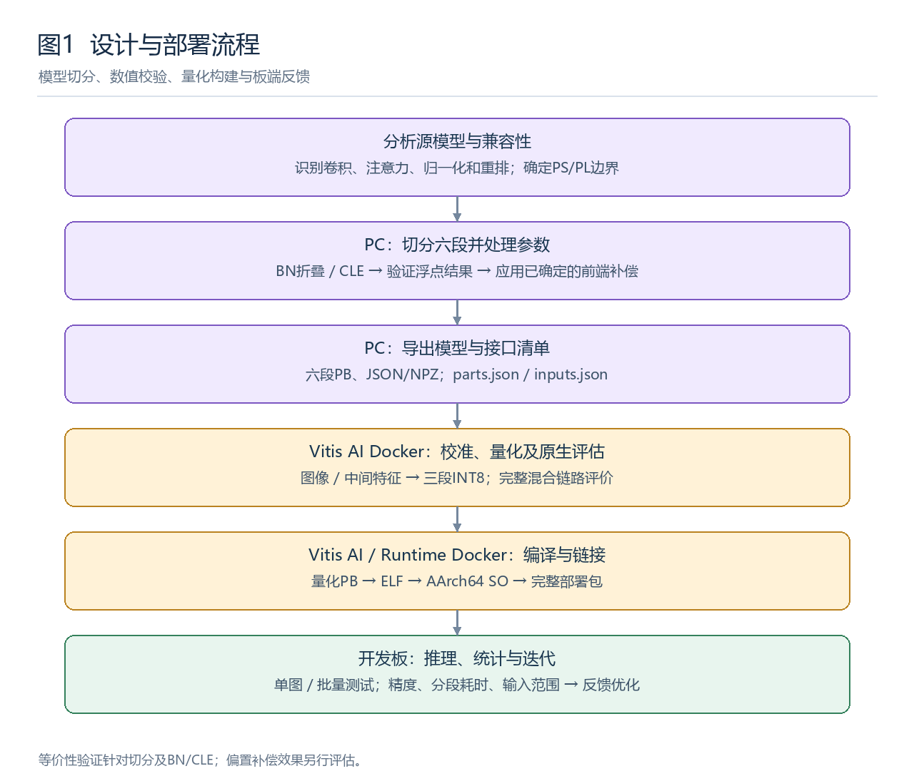
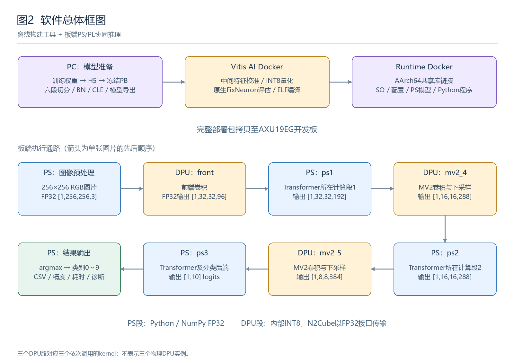
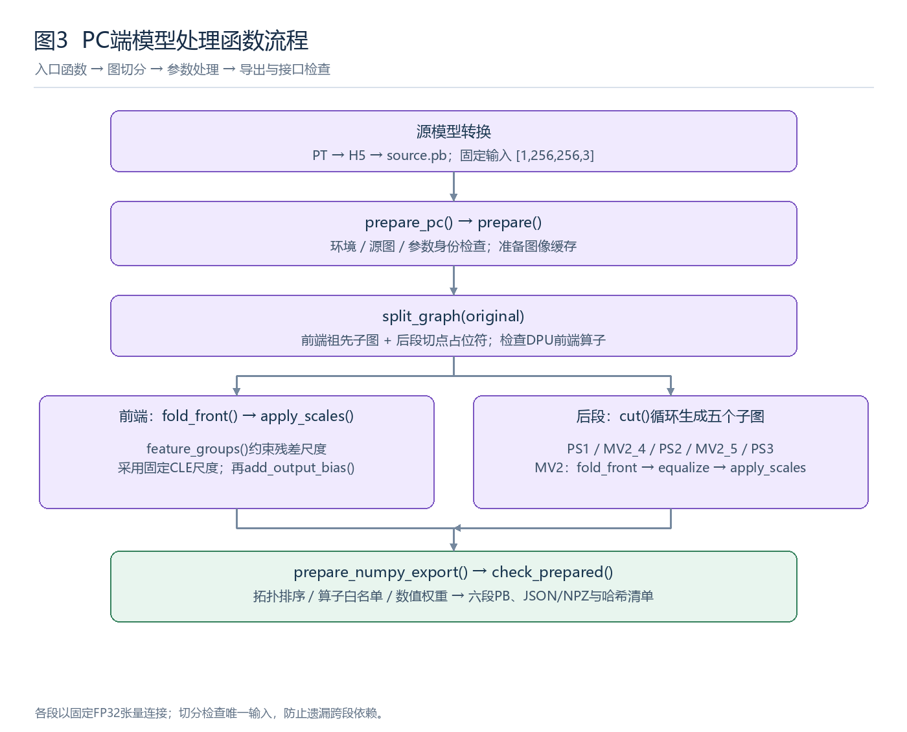
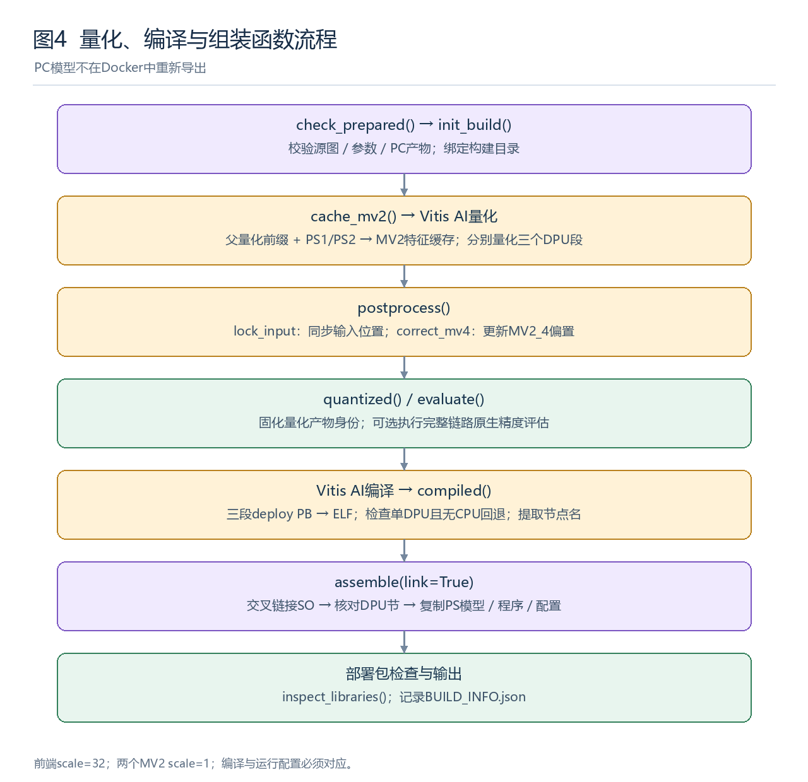
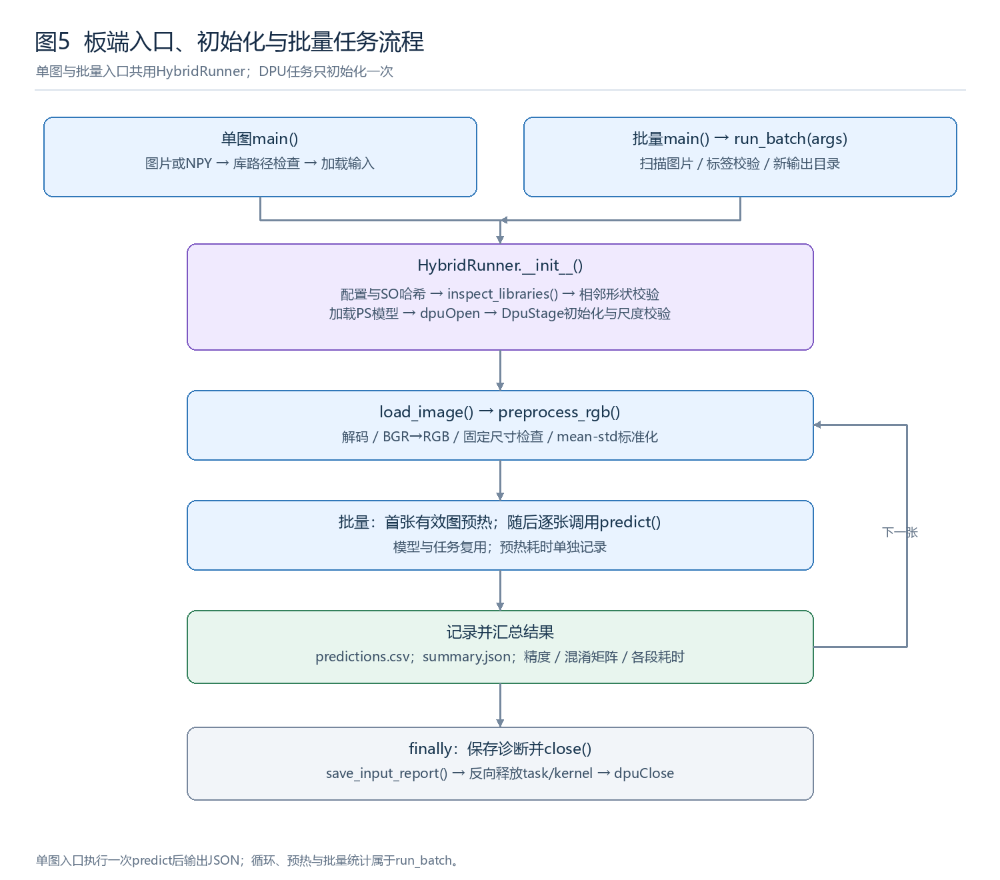
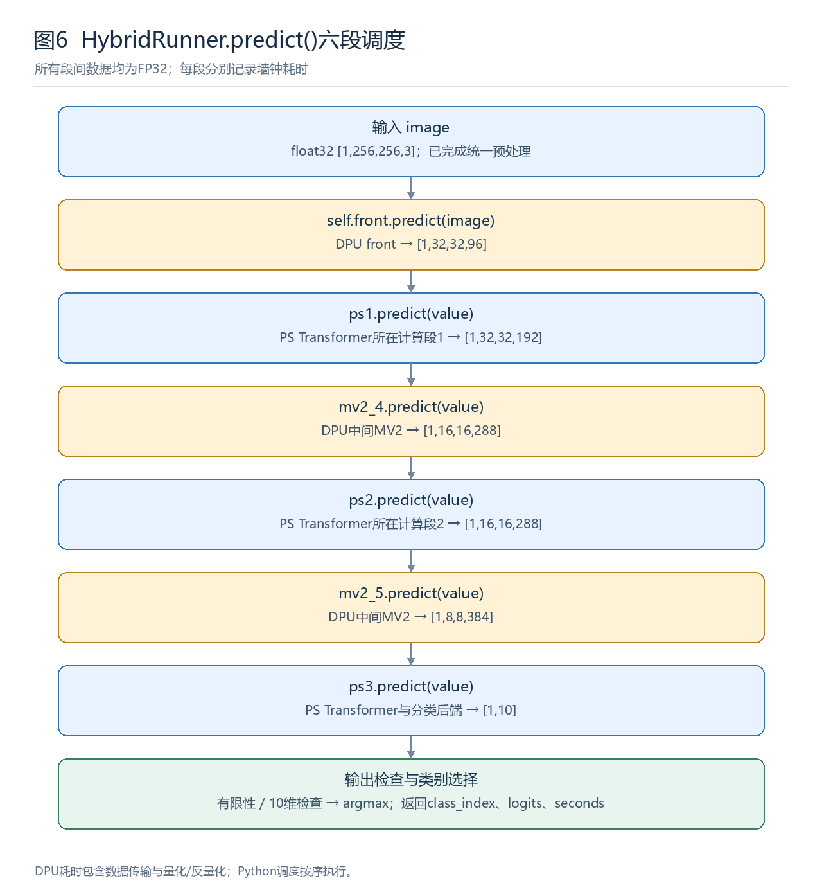
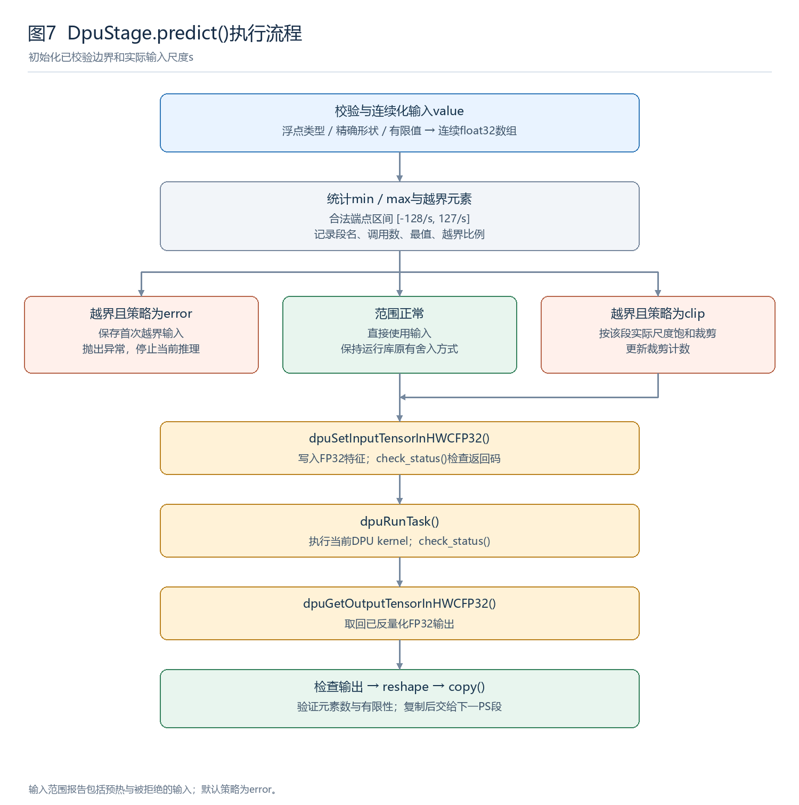
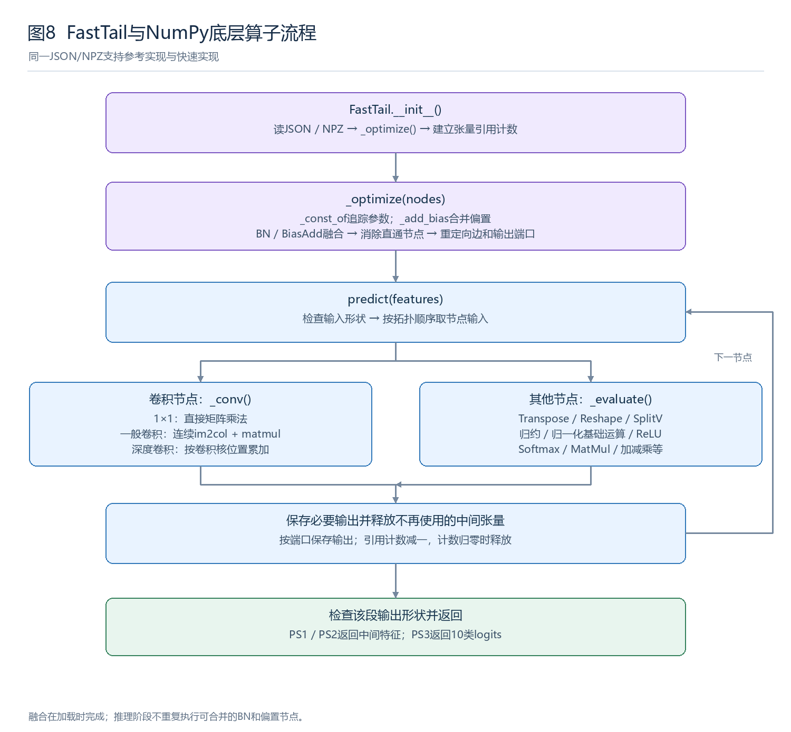
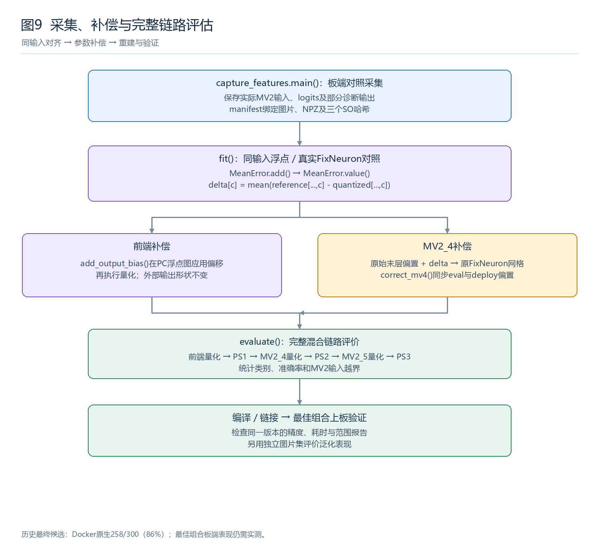

# MobileViTv2 在 AXU19EG 上的 PS/PL 协同部署设计

> 历史资料：保留原测量口径与过程描述。当前提交版的目录、模型选择和操作命令以根目录 README 为准；旧 ONNX 分支和旧 MV2_4 对照包不随本次提交。
## 应用领域

本系统面向车载驾驶员监控与分心驾驶行为识别，可为乘用车、客运车辆及物流车队的驾驶安全管理提供技术支持。模型基于State Farm Distracted Driver Detection数据集微调，识别正常驾驶、左右手发短信、左右手接打电话、操作收音机、饮用饮料、向后伸手、整理头发或化妆、与乘客交谈等10类状态。

系统以256×256图像为输入，将MobileViTv2-0.75部署于ZU19EG平台，通过PS与DPU协同完成本地推理，无需上传驾驶员图像，有助于减少网络传输并保护车内隐私。识别结果可作为分心提醒、行为记录与车队安全分析的输入，为资源受限的车载边缘端提供部署参考。

## 1.1 主要技术特点

本系统基于AXU19EG开发板和MobileViTv2-0.75模型，实现十类图像分类。采用PS/PL异构协同架构，将前端卷积及两个中间MV2模块部署至PL端DPU，三个包含Transformer及后端运算的计算段由PS端Python/NumPy执行，解决现有Vitis AI 1.2工具链对相关算子的部署兼容问题。系统统一使用NHWC特征接口，DPU内部采用INT8计算，PS计算及跨段接口采用FP32。通过BN折叠、通道尺度均衡（CLE）、中间特征校准和偏置校正改善量化精度，并利用卷积融合与矩阵乘法优化PS执行效率。软件覆盖PC模型处理、Docker量化编译、板端推理与结果统计，支持模型文件一致性检查、输入越界诊断和分段耗时分析，板端无需安装TensorFlow。

## 主要性能指标

系统在AXU19EG平台采用PS/DPU协同推理，对256×256图像进行10类驾驶状态识别。300张图像的板端测试结果如下。

| 指标 | 实测结果 |
|---|---|
| 部署平台 | AXU19EG（ZU19EG） |
| 输入尺寸 | 256×256 RGB |
| 测试规模 | 300张，10类驾驶状态 |
| 分类准确率 | 87.00%（261/300） |
| 网络推理耗时 | 485.68 ms/张 |
| 总处理耗时 | 526.66 ms/张（含预处理） |
| DPU三段合计耗时 | 51.81 ms/张 |
| PS三段合计耗时 | 433.88 ms/张 |
| 处理吞吐率 | 1.90 FPS |

注：以上为图片所示批次的板端测试结果。

系统实现亚秒级单图识别，当前主要耗时集中在PS端NumPy计算。

## 1.2 主要创新点

1. 将网络划分为三个DPU段与三个PS段，提取Transformer之间的MV2模块进行硬件加速。
2. 以实际中间特征为依据，联合CLE、顺序校准与偏置校正，并按完整混合链路精度筛选候选。
3. 构建无需TensorFlow的NumPy执行器，通过算子融合、矩阵乘法及中间张量释放提高执行效率。
4. 建立模型、配置、编译产物的哈希绑定与逐段诊断机制，支持部署复现和问题定位。

## 1.3 设计流程

首先分析模型算子及工具链兼容性，确定PS/PL边界；随后在PC端切分六段子图，完成BN折叠、CLE及NumPy模型导出，并核验接口与浮点结果；再在Docker中生成中间特征、完成INT8量化和原生评估，将DPU子图编译、链接为SO；最后组装板端程序，进行单图与批量推理，依据精度、输入范围及分段耗时迭代优化。

## 2.3 软件系统介绍

### 2.3.1 软件整体介绍

系统软件由PC端模型处理工具、Docker构建工具和开发板端推理程序构成。PC端负责模型转换、子图切分、参数处理及模型导出；Ubuntu上的Vitis AI Docker负责量化、原生评估及DPU编译，Runtime Docker负责AArch64共享库链接和部署包组装；板端Python程序统一调度PS与DPU，完成图像输入、六段网络推理、类别输出及统计分析。现有实现通过命令行运行，图像推理可在开发板本地完成，无需云端服务。

图2上部为离线构建流程，下部为板端单张图片的数据通路。图中的三个DPU段是三个独立kernel，程序依次调用；它们不表示开发板上实例化了三个物理DPU。

**（1）开发与运行环境**

| 软件层级 | 环境与主要依赖 | 主要职责 | 主要产物 |
|---|---|---|---|
| PC模型处理 | Windows、TensorFlow 1.15、NumPy；权重转换另使用PyTorch环境 | PT→H5→PB、六段切分、BN/CLE、模型导出及校验 | 六段PB、JSON/NPZ、接口清单和文件哈希 |
| 量化与编译 | Ubuntu、Vitis AI 1.2 Docker | 生成校准特征、INT8量化、真实FixNeuron评估、DPU编译 | 量化PB、ELF、编译日志及评估报告 |
| 链接与组装 | Runtime Docker、AArch64交叉编译器 | ELF→SO，提取实际节点名并组装部署包 | 三个SO、运行配置、板端程序及PS模型 |
| 板端运行 | petalinux 、Python 3.7、NumPy、OpenCV、DNNDK/N2Cube | 预处理、PS/DPU调度、结果与性能统计 | 类别编号、10维logits、CSV与JSON报告 |

**（2）网络执行结构与数据接口**

板端以`runtime_config.json`描述段序、后端、输入输出形状和DPU节点信息。张量统一采用NHWC排列，批量维固定为1；批量测试程序逐张处理图片。DPU内部执行INT8运算，Python通过N2Cube的FP32接口写入和读取数据，由运行库完成相应量化与反量化。

| 顺序 | 计算段 | 执行位置 | 输入形状 | 输出形状 | 主要作用 |
|---|---|---|---|---|---|
| 1 | `front` | PL/DPU | `[1,256,256,3]` | `[1,32,32,96]` | 前端卷积特征提取 |
| 2 | `ps1` | PS/NumPy | `[1,32,32,96]` | `[1,32,32,192]` | 第一个Transformer所在计算段及相邻运算 |
| 3 | `mv2_4` | PL/DPU | `[1,32,32,192]` | `[1,16,16,288]` | 中间MV2卷积与下采样 |
| 4 | `ps2` | PS/NumPy | `[1,16,16,288]` | `[1,16,16,288]` | 第二个Transformer所在计算段及相邻运算 |
| 5 | `mv2_5` | PL/DPU | `[1,16,16,288]` | `[1,8,8,384]` | 第二个中间MV2卷积与下采样 |
| 6 | `ps3` | PS/NumPy | `[1,8,8,384]` | `[1,10]` | 第三个Transformer所在计算段及分类后端 |

上述边界以最终部署配置为准。PS计算段除注意力、归一化、重排等运算外，仍包含部分卷积；当前方案并未将全部卷积迁移至DPU。最终卷积、全局池化与分类层随`ps3`在PS执行。

**（3）文件组织与软件接口**

部署包中的`runtime/`保存Python运行程序，`model/`保存DPU共享库和NumPy模型，`runtime_config.json`保存执行顺序、输入输出节点、形状、输入量化尺度及SO哈希。JSON记录PS计算图、算子属性和权重索引，NPZ保存数值权重；DPU通过SO加载编译结果。PB主要供PC和Docker使用，板端正常推理不需要TensorFlow或PB解释器。

当前配置对应的三个kernel分别为`mobilevitv2_075_fronta_ctlb100`、`mobilevitv2_075_mv4a_ctlb100`及`mobilevitv2_075_mv2_5_cle`。运行时依据配置和共享库内容核验模型身份，防止旧SO、新配置或不同候选文件混用。

**（4）现有验证结果**

前期“前端DPU＋完整NumPy后段”方案在同批300张图片上的板端结果为255/300，准确率85%，平均单图耗时约0.638秒；将两个中间MV2迁移至DPU后的一个早期版本，板端耗时约0.556秒，准确率79%。该记录说明分段迁移获得了约13%的耗时下降，同时存在量化精度损失。

后续保留两个MV2在DPU，分别优化MV2_4与前端。现有最终候选比较报告中，完整三段DPU混合链路的Docker原生评估由252/300提高至258/300，即84%提高至86%。这里的86%是同批数据上的候选筛选结果；最终最佳组合的板端精度、耗时及独立测试集表现仍需另行实测，不能将早期板端耗时与该原生精度组合成同一版本的性能结论。

### 2.3.2 软件各模块介绍

软件按“离线模型准备→量化构建→板端入口→混合调度→DPU/NumPy底层执行→诊断反馈”组织。以下依次给出主要业务函数的流程和关键输入输出；简单文件读写、哈希计算等辅助函数统一列于附表。

#### （1）PC端模型转换、切分与导出模块

该模块将训练权重转换成冻结PB，并按硬件分工生成六段独立子图。前端保留切点全部祖先节点；后续子图将上游切点替换为固定形状的FP32占位符，再从目标输出反向裁剪。切分后检查占位符，防止遗漏跨段依赖，同时检查DPU候选中是否残留不兼容运算。

对DPU候选进行BN折叠和CLE处理，保留残差分支尺度约束；对各段导出JSON计算图和NPZ权重。发布流程使用已确定的前端CLE尺度，两个MV2通过均衡函数生成相应尺度。PC还输出`parts.json`和`inputs.json`，用于后续接口及文件一致性检查。

| 函数 | 关键输入 | 关键输出 | 函数内流程 |
|---|---|---|---|
| `pt_to_npz.main()` | PT权重路径、映射输出路径 | 映射权重NPZ及报告 | 读取训练权重→核对并映射Keras参数名和布局→保存中转权重 |
| `npz_to_h5.main()` | 中转权重NPZ、目标H5路径 | H5权重及校验记录 | 创建同结构TF模型→按名称和形状赋值→保存H5→重新读取核验 |
| `h5_to_pb.main()` | H5、目标PB路径 | 冻结部署PB及验证报告 | 严格加载权重→冻结推理图→静态形状特化→折叠可处理的GN仿射部分→验证后保存 |
| `specialize(original)`、`gn_affine.fold(original)` | 冻结推理图 | 固定batch=1的图、GN仿射处理后的图 | 特化形状及相关常量→保持动态归一化计算，处理可折叠仿射参数 |
| `validate(tf, original, final)` | 转换前后两张图 | 样本误差与类别一致性记录 | 零输入、随机输入、各类图片→分别前向→比较有限性、logits与类别 |
| `prepare_pc(output, recipe_path, refresh, source_pb)` | 源PB、处理参数、输出目录 | 六段模型和清单 | 检查TF环境与源图→准备前端缓存→调用`prepare`→记录接口及哈希→核验产物 |
| `prepare(build, recipe_path, source_path)` | 源图、CLE尺度、前端偏置等参数 | 六段PB及JSON/NPZ | `split_graph`→处理前端→循环`cut`后续各段→处理MV2→导出并记录身份 |
| `split_graph(original)` | 整网`GraphDef` | `front`、`tail` | 校验整网接口→提取前端祖先→用`ps_features`替换切点→裁剪后段→验证边界及算子 |
| `cut(gd, original_input, new_input, output)` | 图、原切点、新输入名、段输出 | 独立段`GraphDef` | 获取切点形状→替换占位符与引用→裁剪→检查唯一输入和跨段依赖 |
| `fold_front(front_def, output_tensor)` | 卷积子图 | 折叠图、卷积层信息 | 查找卷积与推理BN→计算折叠权重和偏置→改写节点→保留输出接口 |
| `feature_groups(...)` | 折叠图、卷积层及边界 | 尺度组、成员、固定边界 | 跟踪特征连接→合并残差两支的尺度组→固定输入输出尺度 |
| `equalize(layers, groups, members, pinned, ...)` | 层、尺度约束和迭代参数 | 通道尺度及优化记录 | 统计相邻层通道范围→迭代更新尺度→施加固定边界约束→输出尺度 |
| `apply_scales(graph_def, layers, scales)` | 子图、层信息、尺度 | 均衡子图及统计 | 补偿相邻层权重与偏置→写回参数→保持外部接口 |
| `prepare_numpy_export(graph_def, input_tensor, output_tensor)` | 段PB及接口名 | 图记录`graph`、权重字典`weights` | 检查算子→拓扑排序→提取常量→记录算子属性→检查NHWC与BN输出端口 |
| `topological_nodes(graph_def)` | 无环计算图 | 拓扑排序节点序列 | 统计入度→依次取零入度节点→更新后继→检查是否存在环 |

BN折叠与CLE属于保持浮点功能的参数变换，切分后应比较中间特征、logits及类别。偏置校正会改变输出，须在等价性验证之后单独评估精度，不能仅以类别一致代替数值校验。

#### （2）校准、量化、编译与组装模块

该模块分别为三个DPU段提供校准输入。前端使用统一预处理后的图像张量；两个MV2使用前序计算得到的中间特征。固定复现流程依据保留的父量化模型生成MV2缓存，并绑定其模型身份与参数，避免更换前缀后仍套用旧校正值。

Vitis AI量化后同步修改输入量化信息：前端位置为5，对应尺度32；两个MV2位置为0，对应尺度1。更新时同时覆盖eval图的输入`FixNeuron`、deploy图输入占位符的`opos`及首层卷积的`ipos`，防止PB与实际SO输入范围不一致。编译采用匹配AXU19EG的硬件描述，要求每个子图仅生成一个DPU kernel，且无CPU回退；链接后检查SO与ELF的DPU代码、参数及元数据段一致。

| 函数或入口 | 关键输入 | 关键输出 | 函数内流程 |
|---|---|---|---|
| `cache_images(images, output)` | `c0`～`c9`图片目录 | 图像NPY缓存、manifest | 枚举图片→校验标签→统一预处理→保存输入张量、标签与哈希 |
| `cache_mv2(front_cache, output, prepared)` | 图像缓存、父量化PB、PS子图 | 两个MV2特征缓存 | 运行量化前端→PS1得到MV2_4输入→父MV2_4→PS2得到MV2_5输入→检查范围并保存 |
| `postprocess(build, stage, recipe_path)` | 量化eval/deploy PB、参数 | 最终量化PB和段标记 | 校验构建身份→`lock_input`→按需`correct_mv4`→核验并保存 |
| `lock_input(eval_gd, deploy_gd, stage)` | eval/deploy图、段名 | 输入量化信息同步后的图 | 确定位置5或0→定位输入路径→同步FixNeuron、Placeholder及卷积元数据 |
| `correct_mv4(eval_gd, deploy_gd, recipe)` | MV2_4量化图、偏置参数 | 校正后的eval/deploy图 | 核验父量化网格→修改eval原始偏置→写入deploy已量化偏置 |
| `check_prepared(prepared)` | PC导出目录 | 验证后的身份信息 | 核验源图、参数、代码、六段接口、模型和缓存哈希 |
| `init_build(build, prepared)` | 构建目录、PC产物 | 构建身份与模型副本 | 检查PC产物→绑定构建目录→复制已导出PB与JSON/NPZ |
| `quantized(build)` | 三段量化结果及标记 | `quantized.json` | 检查eval/deploy文件完整→检查段标记→绑定参数与PB哈希 |
| `compiled(build)` | 编译图、日志、ELF | `compiled.json` | 核验量化输入→检查单DPU且无CPU回退→读取真实节点名→记录ELF及DPU段哈希 |
| `assemble(build, link, sysroot, compiler)` | ELF、编译记录、PC模型 | 完整部署包 | 交叉链接SO→核对DPU段→复制运行程序和模型→更新配置→检查共享库→记录构建清单 |
| `bundle_prebuilt(build, prepared, control)` | 已有SO及匹配PC模型 | 最佳或对照部署包 | 核验固定参数→复制现有SO、配置和新导出模型→检查一致性；不重新编译 |

三个主脚本分别承接量化、编译、链接组装，模型切分和JSON/NPZ导出在PC完成。Docker仅使用已核验的PC产物，不隐式重新导出另一套模型。

#### （3）图像读取与预处理模块

图像模块统一板端输入语义，使推理数据与模型预处理要求一致。图片必须预先准备为256×256，当前函数遇到其他大小直接报错。处理步骤为OpenCV读取BGR图片、转为RGB、转FP32并除以255，再按RGB通道均值`[0.485,0.456,0.406]`和标准差`[0.229,0.224,0.225]`标准化，最后增加批量维。

| 函数 | 关键输入 | 关键输出 | 函数内流程 |
|---|---|---|---|
| `load_image(path)` | 图片路径`path` | `image: float32[1,256,256,3]` | 解码→检查读取成功→BGR转RGB→调用`preprocess_rgb` |
| `preprocess_rgb(rgb)` | `uint8[256,256,3]` RGB数组 | 连续存储的标准化FP32张量 | 检查类型与形状→除以255→减mean并除std→增加批量维 |

两个MV2接收的是PS段计算出的中间特征，直接送入相应DPU接口，不再进行图像归一化。

#### （4）板端入口与批量任务模块

单图入口位于`run_hybrid_board.py`，支持读取图片或预处理NPY。批量入口位于`run_hybrid_batch.py`，按固定顺序扫描图片，并可通过一级子目录`c0`～`c9`取得标签。程序只初始化一次模型与DPU任务，随后逐张复用，避免反复加载共享库和权重。

| 函数 | 关键输入 | 关键输出 | 函数内流程 |
|---|---|---|---|
| `add_options(parser)` | 参数解析器 | 增加公共选项后的解析器 | 注册配置路径、MV2后端、快速PS实现、输入范围策略与跟踪开关 |
| 单图`main()` | `--image`或`--input-npy`及公共选项 | 单图结果JSON | 解析参数→配置库路径→读取输入→创建HybridRunner→推理→输出并释放 |
| 批量`main()` | 图片根目录、输出目录、预热数等 | 批量任务退出状态 | 解析与校验参数→配置库路径→调用`run_batch`→反馈图片错误状态 |
| `run_batch(args)` | 配置、图片列表来源、标签与计时参数 | `summary`及CSV/JSON文件 | 枚举并校验图片→初始化→首张有效图预热→逐图推理与记录→汇总→保存报告并释放 |

`predictions.csv`逐图记录真实标签、预测类别、10个logits和分段耗时；`summary.json`记录成功、失败、未处理数量、准确率、混淆矩阵及平均耗时；`dpu_input_ranges.json`保存各DPU段的输入范围和越界统计。准确率以成功推理且具有标签的图片为基础，失败和未处理数量单独报告。

预热与模型加载不计入平均推理耗时；逐图总耗时包含图像解码、预处理及六段推理。DPU计时包含FP32输入输出传输、量化与反量化。批量吞吐率由批处理墙钟时间计算，包含循环及结果记录开销，因此与平均单图耗时的倒数不必完全一致。

#### （5）配置校验与模型初始化模块

该模块在提交DPU任务前核验文件和运行环境。程序通过共享库检查和SO哈希确认模型身份，通过相邻段形状验证执行链连续性，再建立NumPy执行器和三个DPU任务。实际DPU的输入输出尺寸及输入尺度还要与配置逐项比较，发现不一致即停止。

| 函数 | 关键输入 | 关键输出 | 函数内流程 |
|---|---|---|---|
| `ensure_library_search_path(config_path)` | 配置文件路径 | 可发现部署SO的进程环境 | 定位`model/`→检查库搜索路径→必要时更新环境并重新启动当前进程 |
| `inspect_libraries(config_path, mv2_backend, load)` | 配置、后端选择、加载检查开关 | `passed`和逐库检查结果 | 确认文件存在→检查SO哈希、kernel身份及ELF格式→按需测试动态加载 |
| `elf_kernel_names(raw)` | ELF/SO二进制内容 | 可识别的kernel名称 | 读取ELF节表→解析DPU相关节名→提取kernel标识 |
| `HybridRunner.__init__(...)` | 配置、后端、FastTail选择、范围策略 | 已初始化的`front`、`stages`和`tasks` | 验证段序与SO→检查相邻形状→加载PS模型→打开DPU→创建任务→失败时回收资源 |
| `DpuStage.__init__(api, config, input_shape, output_shape, ...)` | N2Cube接口、段配置、边界形状 | kernel/task、实际尺度、合法输入区间 | 加载kernel→创建task→检查HWC与大小→读取实际scale→比较期望值→建立范围统计 |

三个DPU任务共享已经打开的N2Cube上下文。所有加载、创建和推理调用均检查错误，异常信息保留出错段和关键接口数据。

#### （6）六段混合推理调度模块

`HybridRunner.predict()`是网络推理的核心调度函数。它依次调用前端DPU和配置中的五个后续段，将上一段FP32输出作为下一段输入，并记录各段墙钟耗时。最后检查输出恰为10个有限数值，再通过`argmax`得到类别编号。

| 函数 | 关键输入 | 关键输出 | 函数内流程 |
|---|---|---|---|
| `HybridRunner.predict(image)` | 标准化`image[1,256,256,3]` | `class_index`、`logits[10]`、`seconds` | front→ps1→mv2_4→ps2→mv2_5→ps3→校验10维logits→argmax→汇总耗时 |
| `HybridRunner.save_input_report(directory)` | 输出目录、当前输入统计 | `dpu_input_ranges.json` | 创建目录→序列化三个DPU段统计→写入报告 |
| `HybridRunner.close()` | 已创建的任务列表与打开状态 | 已释放的运行资源 | 反向关闭各DPU段→清空状态→关闭N2Cube |
| `HybridRunner.__enter__()`、`__exit__()` | 上下文进入/退出 | 运行对象或资源释放 | 进入时返回实例；正常结束或异常退出时调用`close()` |

最终类别选择直接作用于分类logits。注意力模块内部的Softmax是模型计算的一部分；分类输出不需要额外Softmax即可完成`argmax`。

#### （7）DPU底层执行与输入范围诊断模块

`DpuStage.predict()`封装N2Cube的FP32输入输出接口。运行前检查输入浮点类型、形状与有限性，将其转换为连续FP32数组；根据运行库返回的实际输入尺度`s`计算合法端点区间`[-128/s,127/s]`，记录最值和越界数量。默认策略为报错并保存首个越界输入；选择`clip`时才执行显式饱和裁剪。统计基于保守FP32端点区间，不替代运行库的舍入实现。

| 函数 | 关键输入 | 关键输出 | 函数内流程 |
|---|---|---|---|
| `DpuStage.predict(value)` | 与该段形状一致的FP32张量 | 反量化后的FP32输出张量 | 检查输入→统计范围→按策略报错或裁剪→写入→执行→读回→校验→复制输出 |
| `check_status(name, status)` | API名称及返回码 | 成功返回或异常 | 接受`0`或接口规定的空返回→其他情况抛出带API名的错误 |
| `DpuStage.close()` | task及kernel句柄 | 已释放的句柄状态 | 销毁task→保证随后销毁kernel→清空句柄 |

底层依次调用`dpuSetInputTensorInHWCFP32()`、`dpuRunTask()`和`dpuGetOutputTensorInHWCFP32()`。返回的FP32输出已由运行库反量化，PS不再额外缩放；程序复制输出后再交给下一段，避免运行库缓冲区复用影响后续结果。前端期望尺度为32，两个MV2为1，加载后必须与实际DPU查询值一致。

#### （8）PS端NumPy执行与加速模块

该模块在板端无TensorFlow环境下执行PS子图。默认使用`FastTail`，并保留`NumpyPSTail`作为参考实现。两者读取相同JSON/NPZ，按依赖关系执行节点。

FastTail在加载时将可融合的推理BN与BiasAdd合入卷积，消除Identity/StopGradient，并同步重定向边和输出端口。推理时，1×1卷积转为矩阵乘法，一般卷积采用连续im2col矩阵乘法，深度卷积按卷积核位置累加；其余算子通过NumPy实现。程序根据后续引用次数释放不再使用的中间张量，减少运行内存占用。

| 函数 | 关键输入 | 关键输出 | 函数内流程 |
|---|---|---|---|
| `FastTail.__init__(graph_path, weights_path)` | JSON和可选NPZ路径 | `graph`、`weights`、优化节点和引用计数 | 检查格式→载入权重→调用`_optimize`→建立张量引用计数 |
| `FastTail._optimize(nodes)` | 节点列表及权重 | 精简节点列表、更新后的权重与输出引用 | 检查消费者→融合BN/BiasAdd→消除直通节点→重连输入与输出 |
| `FastTail._const_of(nodes, edge, by_name)` | 边、节点索引 | 常量节点 | 沿Identity追踪→找到Const→否则报错 |
| `FastTail._add_bias(node, bias)` | 卷积节点、偏置向量 | 更新的偏置权重与节点索引 | 转FP32→合并已有偏置→注册新权重键 |
| `FastTail.predict(features)` | 对应PS段的FP32特征 | 该段FP32输出 | 校验形状→逐节点取输入→调用卷积或算子分派→保存所需输出→释放最后一次使用的张量→检查段输出 |
| `_conv(x, weights, bias, attrs, depthwise)` | 特征、核、偏置、步长/膨胀/填充属性 | 卷积输出 | 校验通道→计算padding及输出大小→选择1×1、一般或深度卷积路径→加偏置 |
| `FastTail._evaluate(op, inputs, attrs)` | 算子类型、输入数组、属性 | 单输出或多输出数组列表 | 按类型分派→执行NumPy运算→将SplitV等多输出按端口返回 |
| `NumpyPSTail.predict(features)` | 同一JSON/NPZ定义的输入 | 参考输出 | 按原图执行已支持算子，作为快速实现与切分结果的数值对照 |

`_evaluate()`覆盖加减乘、ReLU、归约、Reshape、Transpose、SplitV、Softmax、MatMul及归一化所需的基础运算。Softmax先减去最后一维最大值，再计算指数和归一化，以改善数值稳定性。GroupNorm通过均值、方差和倒平方根等原图基础运算组合实现，不能像固定统计量的推理BN一样直接整体折叠。

#### （9）精度补偿、原生评估与板端采集模块

该模块构成精度优化的反馈路径。板端采集保留真实MV2输入和预测结果，部分诊断样本额外保留图像及各DPU输出；Docker将同一输入送入浮点图与真实FixNeuron量化图，按通道累积输出差异，生成偏置补偿。前端补偿在PC浮点图中加入后重新量化；MV2_4补偿在量化后同步更新eval与deploy图。第二个MV2保留固定CLE版本。

通道平均误差为：

`delta[c] = mean(reference[...,c] - quantized[...,c])`

均值跨样本及空间位置统计，以FP64累积、FP32输出。前端将偏移加到输出通道；MV2_4将偏移加到末层原始偏置，再通过原偏置FixNeuron网格得到deploy偏置。当前固定分支的补偿强度为1.0。

| 函数或入口 | 关键输入 | 关键输出 | 函数内流程 |
|---|---|---|---|
| `capture_features.main()` | 对照部署配置、图片及输出目录 | NPZ、manifest、输入范围报告 | 核验对照版本→逐段执行→保存实际中间输入及诊断输出→记录标签、预测和哈希 |
| `fit(capture, front_cache, output, prepared)` | 板端采集、图片缓存、PS模型、父量化模型 | 新`recipe.json`及参数差异报告 | 校验采集身份→同输入运行浮点/量化MV2_4→统计误差→重新量化偏置→拟合前端偏移→输出参数 |
| `MeanError.add(quantized, reference)` | 两个同形状数组 | 通道误差累计值与向量数量 | 转FP64→逐通道求和→更新累计计数 |
| `MeanError.value()` | 已累计的误差与计数 | FP32通道均值`delta` | 检查非空→累计值除以向量数→转FP32 |
| `add_output_bias(gd, offset)` | 浮点前端图、96维偏移 | 增加输出偏置的前端图 | 校验末层与偏移→保留线性卷积→添加Const及BiasAdd→维持外部输出名 |
| `Session.__init__(path, inp, out, shape)` | PB、输入输出名及期望形状 | TensorFlow会话和实际输出端口 | 导入图→识别末端量化输出→核验形状→创建CPU会话 |
| `quantized_output(graph, base, shape)` | 量化图、输出基名、形状 | 真实FixNeuron输出张量 | 优先查aquant→沿直通节点定位→必要时查唯一末端量化输出→核验形状 |
| `Session.run(value)`、`close()` | 输入张量/会话句柄 | 图输出/资源释放 | 执行指定图输出→检查有限性；结束时关闭会话 |
| `evaluate(build, front_cache)` | 三段最终量化PB、三个PS模型、图片缓存 | `native_accuracy.json` | 运行完整六段混合链路→统计MV2输入越界→计算类别和准确率→保存报告 |
| `check_numpy.main()` | 保存的前端特征、重复次数 | 数值自检和PS分段耗时JSON | 完整浮点后段与拆分串联对照→比较logits与类别→重复计时 |

原生评估必须读取真正的末端FixNeuron输出，不能把量化节点之前的浮点张量当作DPU结果。`check_numpy`采用保存特征，不执行DPU；`capture_features`包含压缩写盘，不用于推理测速。采集入口要求配套的原CLE对照配置，不能直接以最终最佳配置替代。

#### （10）辅助函数与异常路径

| 辅助函数 | 输入→处理流程→输出 |
|---|---|
| `read(path)`、`write(path, value)` | 路径/对象→UTF-8 JSON读取或序列化写入→对象/文件 |
| `digest(path)`、`graph_digest(gd)` | 文件/图→SHA256；图按节点名排序后计算→内容指纹 |
| `require(ok, message)` | 判断结果→失败时抛出指定信息→流程继续或停止 |
| `replace_edge(edge, old_name, new_name)` | 边引用与新旧节点名→保留控制边及端口改写→新边引用 |
| `checked_array(path, expected, shape, key)` | 文件与期望哈希/形状→读取并检查float32及有限性→校验后的数组 |
| `front_records(directory)` | 前端manifest→逐条校验图片缓存及范围→样本与输入张量迭代器 |
| `sections(path, kind)`、`boundary(text, shape, block)` | ELF/SO或编译日志→解析DPU节或匹配边界→节哈希/实际节点名 |
| `tensor_key(edge)`、`_tensor_key(edge)` | 张量引用→补齐默认`:0`端口→统一字典键 |
| `edge_name(edge)`、`_edge_name(edge)` | 边或张量名→解析节点名→用于拓扑、索引或替换的名称 |
| `_optimize`内部`producer`、`resolve`、`fold` | 节点/替换表/BN参数→追踪源节点、消解替换链、计算BN折叠→节点引用或更新参数 |
| `ChannelGroups.add/find/union` | 特征名及通道信息→建立、查询、合并尺度约束集合→残差一致的通道组 |
| `scaled_weight/input_ranges/output_ranges` | 卷积层及尺度/权重→尺度补偿和通道范围归约→CLE迭代所需权重与范围 |

主流程在图片解码失败时逐图记录错误并继续处理；遇到模型不匹配、DPU边界错误或输入范围错误时中止推理。批量入口在`finally`路径保存已有统计和输入范围报告；HybridRunner与DpuStage按资源创建关系释放任务和kernel，保证失败记录可用于定位问题。
